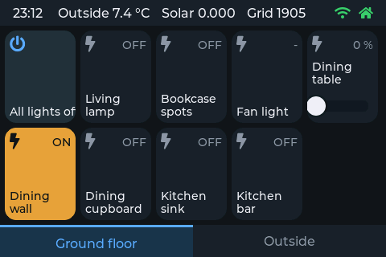
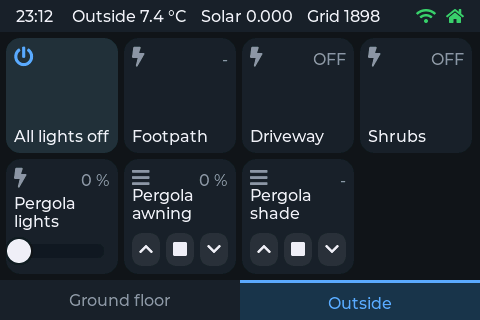

# oh-wallpanel

Touch wall panel firmware for [openHAB](https://www.openhab.org/), written in C with ESP-IDF v6.1 and LVGL 9 for cheap ESP32 display boards.

You configure the panel's screens in openHAB itself, through item tags. Nothing about items is set up on the panel:

- the settings hold an ordered list of screens such as `wp_ground=Ground floor, wp_outside=Outside`;
- every item tagged `wp_ground` appears as a tile on the "Ground floor" screen. Every rule with that tag appears as a scene button;
- items tagged `wp_status` (up to four) appear in the status bar at the top;
- optional `wallpanel` item metadata overrides the label, icon, order, step and min/max.

The panel loads the items over the openHAB REST API and follows their states live over Server-Sent Events (no MQTT). If you retag an item in openHAB, the panel picks up the change within seconds.

 

*WT32-SC01 Plus (480×320) with the compact layout: lights, a dimmer, a dimmer group, two awnings, the "All lights off" button and the status bar with clock, outdoor temperature, solar and grid power.*

## Features

- **Tiles chosen from the item type:**
  - switches;
  - dimmers and colour lights with a slider;
  - rollershutters with up/stop/down;
  - setpoints with −/+;
  - read-only values;
  - dimmer groups;
  - scene buttons for rules.
- **"All lights off"** on every screen with two or more lights.
- **Touch feedback:** a tile shows a pending state until openHAB confirms the change. It flashes red if no new state arrives within 3 s.
- **Navigation:** a tab bar at the bottom, or swipe left and right. The panel returns to the home screen after 60 s without a touch.
- **Compact layout (optional):** shrinks the tiles so every screen fits without scrolling.
- **Screen timeout and night mode:** the screen goes dark after a timeout, and stays dark at night until it is touched. The touch that wakes the screen never switches a tile.
- **Wi-Fi setup:**
  - an access point with a captive portal, plus a QR code on the screen to join it;
  - it joins the strongest access point of a mesh network.
- **Web UI** for settings, status, error log and firmware updates over Wi-Fi. An update that fails its self-check rolls back automatically.
- **Serial console** for diagnostics: `status`, `log`, `set <key> <value>`, `reload`, and `fbdump`, which takes a screenshot.

## Supported boards

| Board | Chip | Display | Touch | Layout |
|---|---|---|---|---|
| [Waveshare ESP32-S3-Touch-LCD-4.3](https://www.waveshare.com/esp32-s3-touch-lcd-4.3.htm) | ESP32-S3, 8 MB flash, 8 MB octal PSRAM | 4.3" 800×480 RGB | GT911 | 4×2 tiles per screen |
| Wireless-Tag / Panlee WT32-SC01 Plus | ESP32-S3, 16 MB flash, 2 MB PSRAM | 3.5" 480×320 ST7796 (8-bit i80) | FT6336 | 3×2 tiles, smaller fonts |
| ESP32-2424S012 (round) | ESP32-C3, 4 MB flash, no PSRAM | 1.28" 240×240 round GC9A01 (SPI) | CST816D | single dimmer |

The round ESP32-2424S012 doesn't show tiles. It acts as a dimmer for one light at a time: a ring around the edge sets the brightness, a tap in the middle toggles the light, and you swipe to the next dimmer. Its antenna socket comes empty on some units. **Fit an external 2.4 GHz antenna on the IPEX/u.FL socket**, or Wi-Fi won't connect.

Pinouts and board details are in [docs/FSD.md](docs/FSD.md), section 2.

## Waveshare 4.3": power supply problems and workaround

The Waveshare board is sensitive to its power supply. These are the problems seen with it, and how the firmware handles them.

**Problem: brownout resets when the backlight switches.** On this board the CH422G I/O expander switches the backlight hard on or off; it can't dim it. On weak USB power, for example a notebook docking station, the current step pulls the board's 3.3 V rail below 2.44 V for a moment. That is the brownout detector's least sensitive level, so the panel resets. With the screen timeout, the backlight switches every few minutes, so this shows up as resets on wake, sometimes several times in a row.

**Workaround: backlight soft start.** The firmware fades the backlight on and off with a 1 ms software PWM on the CH422G. It ramps the share of on-time over `bl_ramp_ms` (default 200 ms), which softens the current step. Measured on a notebook dock:

| `bl_ramp_ms` | Result |
|---|---|
| 0 (hard switching) | brownout after 5 switches |
| 200 (default) | 20 switches, no reset |

The setting is in the web UI under Settings → Display → "Backlight soft start (ms)", or on the console as `set bl_ramp_ms <ms>`. If the board runs from a strong, separate 5 V supply, you can try 0 to switch hard.

**Also seen: an occasional brownout while Wi-Fi connects.** This happened even on a 70 W powered USB hub, which points to the board's own power path (connector, cable or regulator) rather than the supply. The panel just reboots, reconnects and carries on. Use a short, good cable and a 5 V supply of 2 A or more.

**Related firmware settings for this board** (in `boards/esp32s3.defaults` and `sdkconfig.defaults`; don't undo them):

- **Code and read-only data run from flash, not PSRAM.** With them in PSRAM, which also holds the frame buffer, the board crashed with garbage instruction fetches once the LCD and Wi-Fi were both running.
- **Quad I/O flash, a 32 KB instruction cache and 64-byte cache lines.** These keep the display from jumping now that code is fetched from flash over the bus it shares with the PSRAM.
- **The panic handler runs from IRAM.** From flash it hung on cache errors, so crashes looked like silent watchdog resets.

## Building

You need ESP-IDF v6.1. Each board gets its own build directory and sdkconfig:

```sh
idf.py build                                                    # Waveshare 4.3" (default)
idf.py -B build-wt32sc01plus  -D WP_BOARD=wt32sc01plus  build   # WT32-SC01 Plus
idf.py -B build-esp32-2424s012 -D WP_BOARD=esp32-2424s012 build # round ESP32-2424S012
```

For the first flash, use USB: `idf.py -B <dir> flash`, or `esptool.py write_flash @flash_args` inside a CI artifact. GitHub Actions builds all three boards on every push and uploads the images as artifacts.

After the first flash, update over Wi-Fi: upload `oh-wallpanel.bin` on the web UI's Firmware page, or run

```sh
curl --data-binary @build/oh-wallpanel.bin http://<panel-ip>/api/ota
```

## First start

1. The panel opens an access point called `WallPanel-XXXX` and shows a QR code to join it.
2. In the captive portal, enter your Wi-Fi network, the openHAB URL (for example `http://openhab:8080`) and, if your openHAB requires one, an API token.
3. Set the screen list (for example `wp_ground=Ground floor, wp_outside=Outside`) and tag your items in openHAB to match.

## Documentation

[docs/FSD.md](docs/FSD.md) is the full functional specification, with requirement IDs: tile types, openHAB protocol details, display behaviour and the hardware notes for each board.
