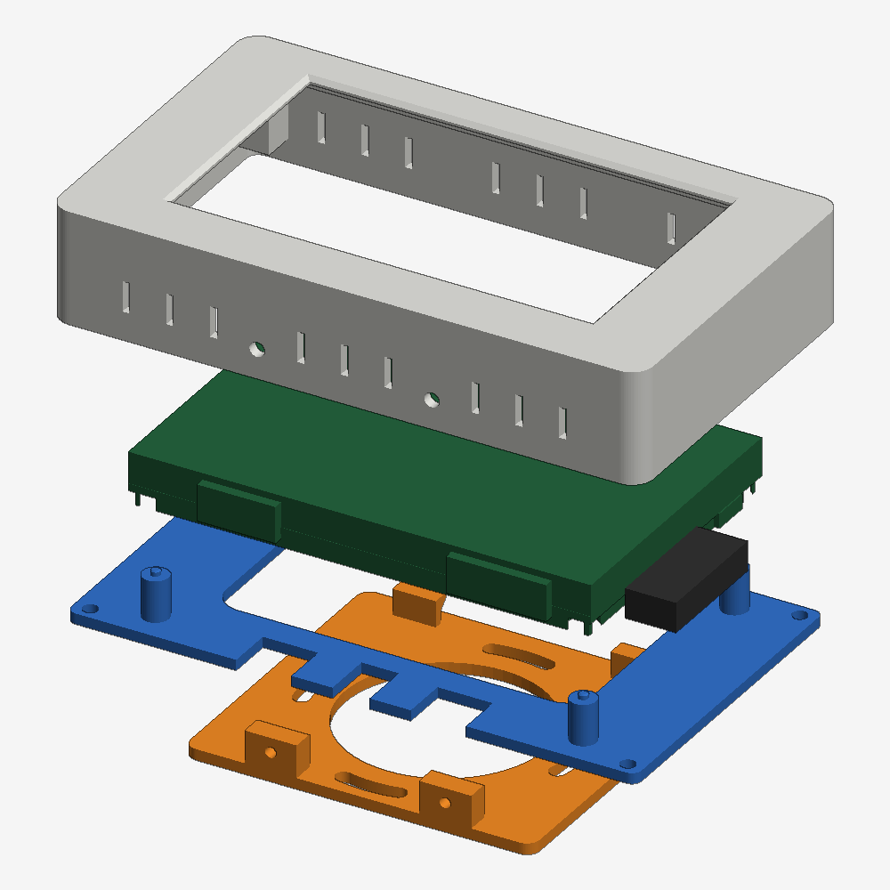
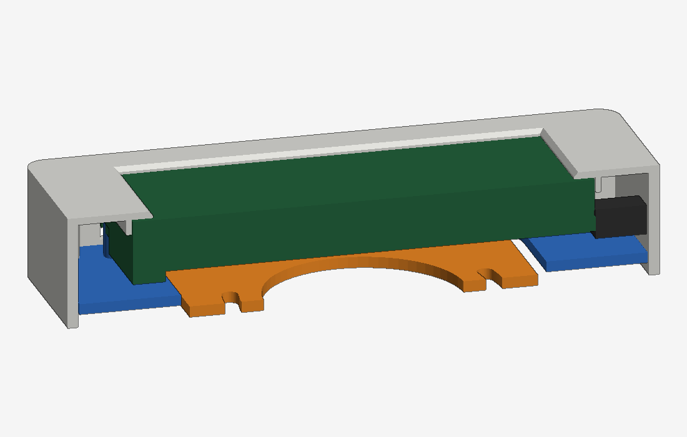
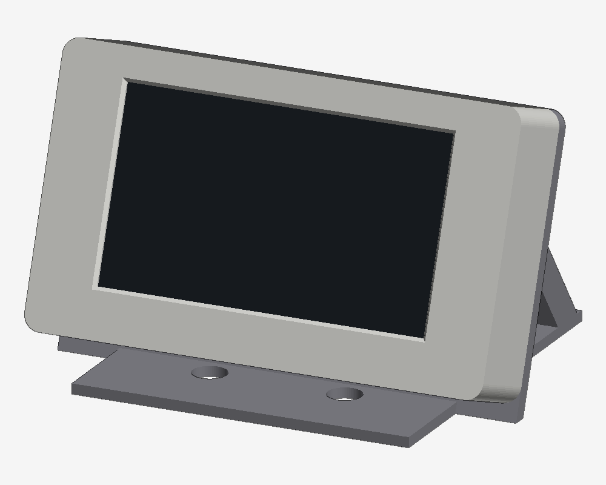
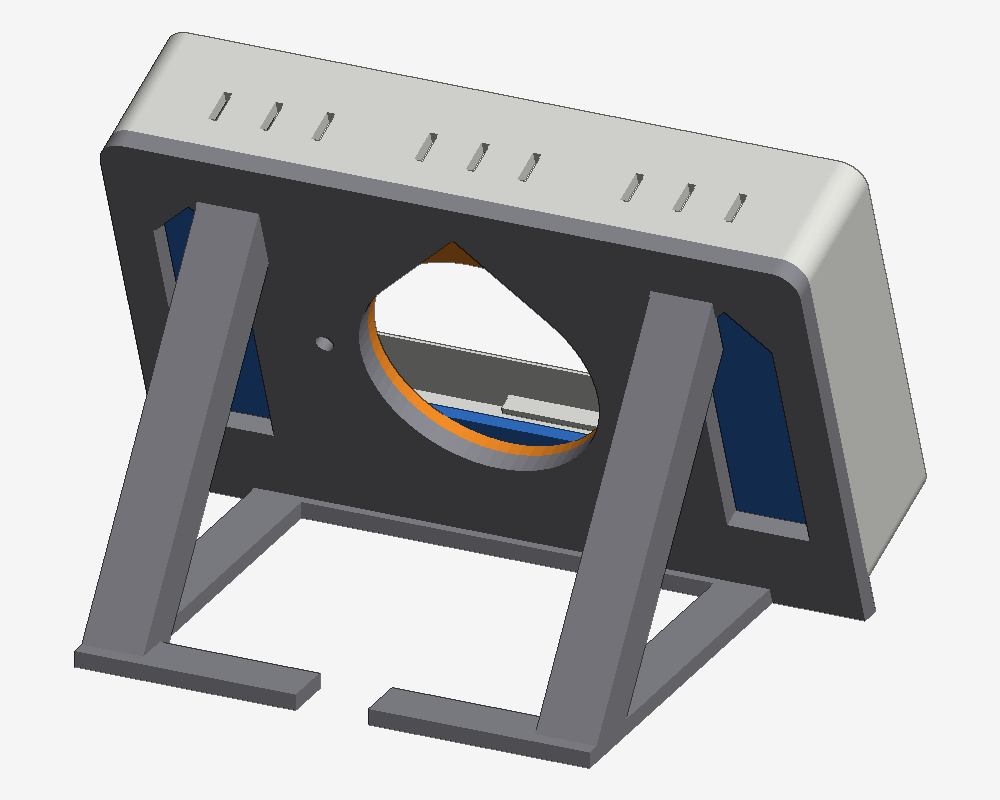

# Wall case for the Waveshare ESP32-S3-Touch-LCD-4.3

A wall case for the touch version of the board. It sits centred over a round flush wall box with a 60 mm screw pitch (the common EU/French box) and takes power from a USB-C cable that comes out of the box. All three parts print without supports.

| File | Part | Print orientation |
|---|---|---|
| `frame.stl` | Front shell, 136 × 80 × 25.8 mm. The display window has a 45° chamfer. Ribs hold the glass in place, and there are gaps at the bottom for the display's flex cables. The right side pocket takes the USB plug. Four corner blocks take the cover screws. Vent slots are in the top and bottom walls, and two screw holes are in the bottom wall. The walls reach the wall and hide the rest. | face down, as exported |
| `back_cover.stl` | Screws into the frame. Four posts with locating pins press the PCB at its mounting holes against the face. It has an opening for the cable and the box screws, windows for the plate's hooks, and notches for its screw tabs. | back down, posts up, as exported |
| `wall_plate.stl` | 80 × 72 × 2.5 mm, screws to the wall box. It has arc slots on both axes, so the box screws can be horizontal or vertical and the panel can be levelled by ±12°. It also has a Ø46 cable hole, two hooks at the top and two screw tabs at the bottom. | back down |

PETG (or PLA), 0.2 mm layers, 3 perimeters. Print the frame in the colour you want: its face is the visible front.

## You need

- **A side-angled USB-C plug** (sold as "90° left/right angle USB-C"). The cable leaves the plug sideways, parallel to the board edge, and runs downward in the pocket. A plug that angles toward the wall ("up/down angle") does **not** fit: that design needs about 35 mm of depth. The pocket is 12 mm wide (`PLUG_X`) and 28 mm long (`PLUG_UP`, `PLUG_DOWN`).
- A 5 V USB power supply in the wall box (≥ 2 A, see the power notes in the main README).
- 4 × M3×8 pan-head screws for plastic (cover to frame) and 2 × M3×10 (frame to plate, from below).
- Optional: a 0.5 mm felt or foam strip on the inside of the face around the window (`FOAM`). It cushions the glass and takes up tolerance.

## Assembly

1. Lay the panel face down in the frame. With the screen facing you, the USB-C ports are on the right and the wide black bezel is at the bottom.
2. Plug the cable into the **USB** port (the lower one, near the middle of the edge) with the cable pointing down, and lead it to the cover's central opening.
3. Put the cover on. The pins go into the PCB's mounting holes. Fix it with the 4 M3×8 screws.
4. Screw the wall plate to the box (hooks at the top) and level it in the slots. Plug the cable into the supply in the box.
5. Hold the unit 2.6 mm above its final position and push it flat against the wall, so the hooks go through the cover's windows. Slide it down, then lock it with the 2 M3×10 screws from below.

To take it off, remove the two bottom screws, slide the unit up and pull it off.

## Check before printing

These values are not on Waveshare's drawing, or are only estimates. Measure your board and change the parameters at the top of `case.py`:

| Parameter | Value | What |
|---|---|---|
| `STANDOFF_H` | 4.0 | height of the standoffs fitted in the PCB holes (measured about 4 mm). The cover's posts press on their ends, and the pins (Ø2.2, `PIN_D`) go into their bores |
| `HOLE_D` | 3.0 | PCB mounting hole diameter (only used by the board dummy now) |
| `STACK` | 8.8 | glass front to PCB back face (from the drawing's side view) |
| `BACK_CLEAR` | 9.5 | free space behind the PCB, for the tallest part on the back. The jumpers on the CAN/RS485 headers are estimated at ~8.5 mm. If you pull them off (CAN/RS485 are unused) and the bare header is lower, you can reduce this and the case gets thinner. |
| `TAILS` | | x ranges where the display flex cables wrap around the bottom edge; the bottom ribs must stay clear of them |
| `PLUG_*` | | the size of your cable's plug head |

## Files

`case.py` is parametric and needs `manifold3d`, `numpy` and `trimesh`; here run it with
`PYTHONPATH=/workspace/tools/cadlib /workspace/esp/bin/python3 case.py`. It rewrites the STL files and the STEP file. It also checks for clashes between the parts, the board dummy and the plug dummy, both assembled and in the hook-on position, and checks that each part is a single piece. It fails if anything clashes. `case_assembly.step` is the coloured assembly for FreeCAD or Fusion 360 (planar faces; round parts faceted), written by `step_export.py` without a CAD kernel. `preview_*.stl` are the dummies, and `preview_*.png` are renders. `test_frame_corner.stl` and `test_cover_corner.stl` are the bottom-right corners of the frame and cover (glass ribs, corner screw, a post with its pin, the USB plug pocket) for a quick fit test before printing the whole case.

Board data comes from Waveshare's dimension drawing for the touch version (glass 106.10 × 67.80 mm, active area 95.54 × 54.36 mm, holes 98 × 60 mm, USB at 32.90 mm and UART at 12.93 mm from the top edge on the back view).

## Desk variant

The same frame, back cover and wall plate fit on `desk_stand.stl`, a tilted board that takes the place of the wall. The frame's rim rests on it as it would on a wall, and the unit hooks on the same way. Assembled, it is 136 wide × 110 deep × 88 mm high, with the screen tilted back 20° (`TILT` in `desk.py`).

| File | Part | Print orientation |
|---|---|---|
| `desk_stand.stl` | 136 × 110 × 80 mm, 66 cm³. It has a tilted board with a cable hole and two side windows, a base ring, and two rear legs at about 53°. The cable hole has a pointed top, so it prints without support. | base down, as exported |

- Bolt the wall plate to the board with **2 × M3×10 + nuts and washers** through its horizontal arc slots. The hooks go at the top.
- The cable runs from the cover's opening through the board, drops into the hollow stand, and leaves through the gap in the rear rail.
- The frame's 2 bottom screws are optional on a desk, because gravity keeps the unit on the hooks. To fit them, lift the stand: the two holes in the base's front strip line up with them.
- Stick small rubber feet under the base. The stand is light, so a firm press near the top of the screen can tip it back. Increase `REAR` if that happens.

`desk.py` imports `case.py`. It writes `desk_stand.stl` and `desk_assembly.step`, and checks the stand for clashes with the unit and the plate, both seated and in the hook-on position.
